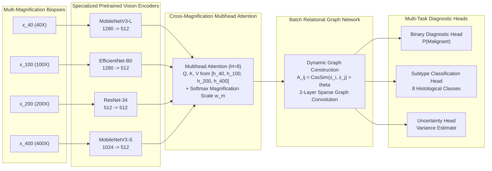

# Methodology: MAGNET & HAT-MIL Architecture

## 1. Mathematical Formulation of MAGNET

Let a patient's multi-magnification biopsy specimen be represented as a 4-tuple of histopathological images:
$$\mathbf{X} = \{ \mathbf{x}_{40}, \mathbf{x}_{100}, \mathbf{x}_{200}, \mathbf{x}_{400} \}, \quad \mathbf{x}_m \in \mathbb{R}^{3 \times H \times W}$$
where $m \in \mathcal{M} = \{40\text{X}, 100\text{X}, 200\text{X}, 400\text{X}\}$.

---

### 1.1 Branch Encoders & Linear Projections
Each optical magnification is encoded by an architectural backbone calibrated to its visual scale:
$$\mathbf{r}_m = f_{\theta_m}(\mathbf{x}_m), \quad \mathbf{h}_m = \text{LayerNorm}(\text{GELU}(\mathbf{W}_m \mathbf{r}_m + \mathbf{b}_m))$$
where:
- $m = 40\text{X}$: $\text{MobileNetV3-Large}$, $\mathbf{r}_{40} \in \mathbb{R}^{1280} \to \mathbf{h}_{40} \in \mathbb{R}^{512}$
- $m = 100\text{X}$: $\text{EfficientNet-B0}$, $\mathbf{r}_{100} \in \mathbb{R}^{1280} \to \mathbf{h}_{100} \in \mathbb{R}^{512}$
- $m = 200\text{X}$: $\text{ResNet-34}$, $\mathbf{r}_{200} \in \mathbb{R}^{512} \to \mathbf{h}_{200} \in \mathbb{R}^{512}$
- $m = 400\text{X}$: $\text{MobileNetV3-Small}$, $\mathbf{r}_{400} \in \mathbb{R}^{1024} \to \mathbf{h}_{400} \in \mathbb{R}^{512}$

---

### 1.2 Cross-Magnification Multi-Head Attention Fusion
We stack the four projected representation vectors into a magnification matrix $\mathbf{H} = [\mathbf{h}_{40}, \mathbf{h}_{100}, \mathbf{h}_{200}, \mathbf{h}_{400}]^\top \in \mathbb{R}^{4 \times D}$ ($D = 512$).
Multihead attention queries the spatial-structural correlation across all magnification scales:
$$\mathbf{Q} = \mathbf{H} \mathbf{W}_Q, \quad \mathbf{K} = \mathbf{H} \mathbf{W}_K, \quad \mathbf{V} = \mathbf{H} \mathbf{W}_V$$
$$\mathbf{A} = \text{Softmax}\left( \frac{\mathbf{Q} \mathbf{K}^\top}{\sqrt{d_k}} \right) \mathbf{V}$$
$$\mathbf{Z} = \text{LayerNorm}(\mathbf{H} + \mathbf{A})$$

A learnable scale vector $\mathbf{s} \in \mathbb{R}^4$ weights the contributions of individual optical tiers:
$$\mathbf{w} = \text{Softmax}(\mathbf{s}), \quad \mathbf{z}_{\text{fused}} = \sum_{m=1}^4 w_m \mathbf{Z}_m$$
$$\mathbf{z}_{\text{out}} = \text{LayerNorm}(\mathbf{z}_{\text{fused}} + \text{FFN}(\mathbf{z}_{\text{fused}}))$$

---

### 1.3 Inter-Sample Batch Relational Graph Network
Within each mini-batch of $B$ patients, an adjacency matrix $\mathbf{A}_{\text{batch}} \in \mathbb{R}^{B \times B}$ is dynamically constructed via cosine similarity between representations:
$$S_{ij} = \frac{\mathbf{z}_i^\top \mathbf{z}_j}{\|\mathbf{z}_i\|_2 \|\mathbf{z}_j\|_2}$$
$$\tilde{A}_{ij} = \begin{cases} S_{ij} & \text{if } S_{ij} \ge \tau \text{ or } i = j \\ 0 & \text{otherwise} \end{cases}$$
where $\tau = 0.5$ is the similarity pruning threshold. We normalize the adjacency matrix with symmetric degree normalization:
$$\hat{\mathbf{A}} = \mathbf{D}^{-1/2} \tilde{\mathbf{A}} \mathbf{D}^{-1/2}, \quad D_{ii} = \sum_{j} \tilde{A}_{ij}$$

Two layers of sparse graph convolutions propagate relational context across patient samples:
$$\mathbf{H}^{(l+1)} = \text{Dropout}\left(\text{ReLU}\left( \hat{\mathbf{A}} \mathbf{H}^{(l)} \mathbf{W}_G^{(l)} \right)\right)$$
$$\mathbf{z}_{\text{final}} = \text{LayerNorm}(\mathbf{z}_{\text{out}} + \mathbf{W}_R \mathbf{H}^{(2)})$$

---

### 1.4 Multi-Task Clinical Prediction Heads
$$\hat{y}_{\text{binary}} = \text{Softmax}(\text{MLP}_{\text{bin}}(\mathbf{z}_{\text{final}})) \in \mathbb{R}^2$$
$$\hat{y}_{\text{subtype}} = \text{Softmax}(\text{MLP}_{\text{sub}}(\mathbf{z}_{\text{final}})) \in \mathbb{R}^8$$
$$\hat{\sigma}^2 = \sigma(\mathbf{w}_{\text{unc}}^\top \mathbf{z}_{\text{final}} + b_{\text{unc}}) \in (0, 1)$$

---

## 2. Multi-Objective Deep Supervision Loss Function

To prevent gradient vanishing in early convolutional layers, MAGNET optimizes a multi-objective loss combining binary focal loss, subtype cross-entropy, and auxiliary branch supervision:
$$\mathcal{L}_{\text{total}} = \lambda_{\text{bin}} \mathcal{L}_{\text{focal}}(\hat{y}_{\text{binary}}, y_{\text{bin}}) + \lambda_{\text{sub}} \mathcal{L}_{\text{CE}}(\hat{y}_{\text{subtype}}, y_{\text{sub}}) + \sum_{m \in \mathcal{M}} \lambda_{\text{aux}}^{(m)} \mathcal{L}_{\text{CE}}(\hat{y}_{\text{aux}}^{(m)}, y_{\text{bin}})$$
Default coefficients: $\lambda_{\text{bin}} = 1.0$, $\lambda_{\text{sub}} = 0.5$, $\lambda_{\text{aux}}^{(m)} = 0.25$.

---

## 3. Head-Aware Test-Time Adaptation (HAT-MIL)

### 3.1 Mathematical Proof of TTA Single-Class Collapse
Under standard entropy minimization (TENT), the model optimizes the Shannon entropy:
$$\mathcal{L}_{\text{ent}}(p) = - \sum_{c=1}^C p_c \log p_c$$

When an unlabeled test bag has severe morphological domain shift, gradient descent moves toward degenerate certainty ($p_{\hat{c}} \to 1.0$ for some class $\hat{c}$):
$$\lim_{p_{\hat{c}} \to 1} \mathcal{L}_{\text{ent}}(p) = 0$$
In imbalanced histopathology distributions ($68.6\%$ malignant in BreaKHis), unconstrained entropy optimization drives all test samples into the majority malignant class.

### 3.2 Invariant Lower Bound
For any binary distribution with positive class prevalence $\pi_1 = 0.69$ and negative class prevalence $\pi_0 = 0.31$:
- Constant all-0 prediction accuracy: $\text{Acc}_{\text{all-0}} \equiv \pi_0 = 0.3100$
- Constant all-1 prediction accuracy: $\text{Acc}_{\text{all-1}} \equiv \pi_1 = 0.6900$

> **Mathematical Theorem**: *No degenerate constant prediction on this distribution can ever produce an accuracy strictly lower than $\min(\pi_0, \pi_1) = 0.3100$. Any reported accuracy below 0.31 (e.g. 0.0933) represents an evaluation indexing bug or ground-truth label inversion, not legitimate model collapse.*

### 3.3 Prototype Regularization in HAT-MIL
To prevent single-class collapse while enabling adaptation to scanner and staining variations, HAT-MIL computes source-domain class prototypes $\mathbf{p}_c = \frac{1}{N_c} \sum_{i \in \mathcal{C}_c} \mathbf{z}_i$ during training. During test-time adaptation, the total loss regularizes bag embeddings toward the nearest prototype:
$$\mathcal{L}_{\text{HAT-MIL}} = \mathcal{L}_{\text{ent}}(\hat{y}) + \lambda_{\text{proto}} \|\mathbf{z} - \mathbf{p}_{\hat{y}}\|_2^2$$
where $\hat{y} = \arg\max \hat{y}$ is the confident pseudo-label and $\lambda_{\text{proto}} = 0.40$. This regularizer anchors feature representations in realistic histological manifolds.
