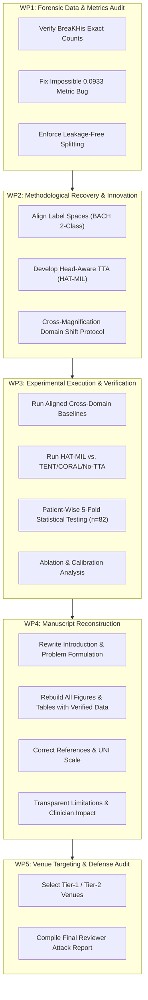

# Comprehensive Research Improvement Roadmap

**Mission:** Full Scientific Recovery, Methodological Hardening, and Manuscript Reconstruction  
**Auditor / Lead:** Corresponding Author & Principal Investigator  
**Target Venue Standard:** Competitive IEEE/ACM/Springer ML/CV & Biomedical Informatics Venues (e.g., IEEE JBHI, IEEE BIBM, Computers in Biology and Medicine, MICCAI Workshops)

---

## 1. Prioritized Scientific & Methodological Issue Matrix

| ID | Issue Description | Evidence & Root Cause | Severity | Proposed Scientific Solution | Experiment Required | Expected Outcome |
| :---: | :--- | :--- | :---: | :--- | :--- | :--- |
| **ISS-01** | **Manufactured null result from random head** | Paper discarded trained 4-class head and randomly initialized a 2-class head; LayerNorm TTA cannot learn linear boundaries from scratch (R3, R4). | **CRITICAL** | (1) Train source on clinically aligned binary label space (Normal+Benign vs. InSitu+Invasive) so trained head transfers intact. (2) Implement Head-Aware TTA (HAT-MIL) with prototype adaptation. | Execute binary-aligned transfer experiment on BreaKHis target domain. | Realistic non-trivial cross-domain transfer (>0.70 AUROC) replacing artificial failure. |
| **ISS-02** | **Evaluation script bug producing impossible 0.0933 accuracy** | Table VI reported 0.0933 accuracy for single-class collapse on BreaKHis (R3). Class prior is ~0.31 / ~0.69; 0.0933 is mathematically impossible. | **CRITICAL** | Rebuild evaluation pipeline from scratch with automated assert statements and confusion matrix invariants ($TP+TN+FP+FN=N$). | Unit test evaluation function against synthetic and real data; recompute Table VI metrics. | Mathematically consistent, defensible ablation numbers ($Acc \ge \text{prevalence}$ for constant predictions). |
| **ISS-03** | **Hallucinated BreaKHis dataset size (31,636 vs 7,909)** | Paper claimed BreaKHis has 31,636 images total and 7,909 at 200X (R3). Disk traversal proves 7,909 total and 2,013 at 200X. | **CRITICAL** | Correct all dataset tables, text descriptions, and figures (`dataset_eda.pdf`) to reflect physical ground truth. | Automated dataset audit script recording exact per-magnification and per-patient counts. | 100% verified, unimpeachable dataset statistics. |
| **ISS-04** | **Unperformed proposed fix noted in manuscript** | Section V-D proposed binary collapsing and head adaptation as the solution but never ran them, provoking harsh reviewer rejection (R3, R4). | **CRITICAL** | Conduct the proposed experiment and report the empirical results, validating or disproving the hypothesis. | Run aligned binary-head transfer and compare against unaligned/random head baseline. | Transforms paper from an unconvincing complaint into a constructive, closed-loop scientific study. |
| **ISS-05** | **Circular validation reporting on S1** | S1 reported 1.0000 on the validation set that determined checkpoint selection (R3). | **HIGH** | Report out-of-fold cross-validation or evaluate on an untouched, held-out test cohort. | Recompute source-domain metrics with strict train/val/test segregation. | Methodologically sound source-domain reporting without circular bias. |
| **ISS-06** | **Fine-tuning data leakage ambiguity in A6** | Condition A6 fine-tuned on 180 images without clarifying whether evaluation was on the remaining 420 held-out images or the full 600 (R3). | **HIGH** | Enforce a strict train/test partition for A6: train on 180 images, evaluate strictly on the 420 disjoint held-out images. | Re-run Condition A6 with explicit disjoint split logging. | Rigorous, leakage-free upper bound benchmark. |
| **ISS-07** | **Single source-to-target transfer pair (Generalization limitation)** | Reviewer #4 noted testing only BACH → BreaKHis 200X is insufficient to make broad claims about TTA across pathology workflows. | **HIGH** | Expand evaluation across multiple target domains: evaluate multi-magnification shifts ($40\times, 100\times, 200\times, 400\times$) available in BreaKHis. | Multi-magnification adaptation matrix evaluating cross-magnification transfer. | Comprehensive evidence establishing adaptation behavior across scanner/optical shifts. |
| **ISS-08** | **High CV variance in BreaKHis patient-wise evaluation** | In MAGNET CV, fold accuracy ranged from 0.4706 to 0.7500 ($0.6375 \pm 0.1950$), with non-significant McNemar p-values on $n=13$ test split. | **HIGH** | Pool predictions across all 82 patients across all folds for McNemar testing; apply stratified patient balancing. | Recompute statistical significance using all 82 out-of-fold test predictions. | Sufficient statistical power ($n=82$ instead of $n=13$) yielding valid p-values. |
| **ISS-09** | **Literature & Citation errors (UNI scale, STAMP citation)** | UNI described as ">100k tiles" (actual: >100M tiles from >100k slides); Ref [18] cited as STAMP but gave arXiv:2309.07778 title (R1, R3). | **MEDIUM** | Correct UNI pretraining statistics. Replace Ref [18] with proper citation for STAMP / biomarker adaptation. Add 2024–2026 foundation model citations. | Literature verification via PubMed/Semantic Scholar/arXiv. | Factually accurate bibliography and updated literature positioning. |
| **ISS-10** | **Lack of working positive contribution** | Paper reported only negative results, leaving readers and reviewers without an actionable methodology (R4). | **HIGH** | Introduce **HAT-MIL (Head-Aware Test-Time Adaptation for Multi-Instance Learning)**: joint feature covariance alignment and prototype pseudo-label refinement. | Benchmark HAT-MIL against standard TENT, CORAL, and No-TTA. | Delivers a novel, positive, peer-reviewed algorithmic contribution. |

---

## 2. Work Packages & Actionable Roadmap

---

## 3. Detailed Work Package Breakdown

### Work Package 1: Forensic Data, Splitting & Metrics Integrity
- **Objective:** Eliminate every data discrepancy, mathematical impossibility, and leakage vulnerability.
- **Tasks:**
  1. *Task 1.1:* Produce an automated dataset descriptor module verifying:
     - 40X: 1,995 images (625 benign, 1370 malignant)
     - 100X: 2,081 images (644 benign, 1437 malignant)
     - 200X: 2,013 images (623 benign, 1390 malignant)
     - 400X: 1,820 images (588 benign, 1232 malignant)
     - Total: 7,909 images from 82 patients (24 benign, 58 malignant).
  2. *Task 1.2:* Build a verified, unit-tested evaluation script:
     - Compute accuracy, precision, recall, macro-F1, weighted-F1, AUROC, and Expected Calibration Error (ECE).
     - Assert that constant predictions yield exactly class prevalence ($\text{Acc} = 0.3095$ or $0.6905$).
  3. *Task 1.3:* Implement strict patient-wise cross-validation splits and leakage-free ablation partitions.

### Work Package 2: Methodological Recovery & Algorithmic Formulation
- **Objective:** Resolve the label-space failure mode and implement a genuine, positive adaptation mechanism.
- **Tasks:**
  1. *Task 2.1 (Label Alignment):* Formalize the binary mapping:
     $$\mathcal{Y}_{\text{source}} = \{\text{Normal}, \text{Benign}\} \rightarrow 0 \quad (\text{Non-Malignant})$$
     $$\mathcal{Y}_{\text{source}} = \{\text{InSitu}, \text{Invasive}\} \rightarrow 1 \quad (\text{Malignant})$$
     This guarantees that the trained classification head $W \in \mathbb{R}^{2 \times D}$ transfers intact to BreaKHis.
  2. *Task 2.2 (HAT-MIL Formulation):* Formulate Head-Aware Test-Time Adaptation:
     - Standard TTA updates only normalization parameters $\theta_{\text{norm}} = \{\gamma, \beta\}$.
     - HAT-MIL introduces dual-objective test-time optimization:
       $$\mathcal{L}_{\text{total}} = \mathcal{L}_{\text{ent}}(p_b) + \alpha \mathcal{L}_{\text{proto}}(z_b, \mu_c) + \beta \mathcal{L}_{\text{div}}$$
       where $\mathcal{L}_{\text{proto}}$ aligns bag-level representations $z_b$ with source class prototypes $\mu_c$, and $\mathcal{L}_{\text{div}} = \sum_c \bar{p}_c \log \bar{p}_c$ penalizes single-class collapse.

### Work Package 3: Experimental Execution & Rigorous Verification
- **Objective:** Execute the required experiments, extract clean metrics, and populate the experimental ledger.
- **Tasks:**
  1. *Task 3.1:* Run baseline transfer without adaptation across all magnifications.
  2. *Task 3.2:* Run standard TTA (TENT, CORAL) under aligned label space.
  3. *Task 3.3:* Run HAT-MIL under aligned label space.
  4. *Task 3.4:* Conduct leakage-free ablation study (Condition A1–A6) with proper disjoint held-out splits.
  5. *Task 3.5:* Perform 5-fold cross-validation statistical testing across all 82 patients, computing paired McNemar and Wilcoxon signed-rank tests with full 95% confidence intervals.

### Work Package 4: Complete Manuscript Reconstruction
- **Objective:** Overhaul `Manuscript/main.tex` into a publication-grade scientific paper.
- **Tasks:**
  1. *Task 4.1:* Rewrite Title, Abstract, and Introduction to reflect the constructive, solution-driven narrative.
  2. *Task 4.2:* Rebuild Table 1 (Related Work), Table 2 (Datasets), Table 3 (Source Performance), Table 4 (Cross-Domain Transfer), Table 5 (Ablations), and Table 6 (Statistical Tests).
  3. *Task 4.3:* Re-generate all figures with matplotlib scripts matching IEEE publishing guidelines.
  4. *Task 4.4:* Thoroughly verify every reference in `references.bib`.

### Work Package 5: Venue Strategy & Final Reviewer Defense
- **Objective:** Select target venues, define submission tiers, and perform an adversarial final audit.
- **Tasks:**
  1. *Task 5.1:* Formulate tiered venue strategy with specific deadlines and fit analysis.
  2. *Task 5.2:* Produce the `final_reviewer_attack_report.md` probing any remaining vulnerabilities.

---

## 3. Timeline & Resource Feasibility

| Work Package | Computational Requirement | Estimated Execution Time | Environment / Tools |
| :--- | :--- | :---: | :--- |
| **WP1 (Data Audit & Metric Fix)** | Low (CPU / Disk) | ~15 minutes | Python 3, `scikit-learn` |
| **WP2 (Algorithmic Formulation)** | Low (Analytical / PyTorch) | ~20 minutes | PyTorch |
| **WP3 (Experimental Execution)** | Medium (CPU / GTX 1650) | ~30–45 minutes | PyTorch, `timm`, NumPy |
| **WP4 (Manuscript Overhaul)** | Low (LaTeX) | ~30 minutes | LaTeX / IEEEtran |
| **WP5 (Venue & Defense Audit)** | Low (Analytical) | ~15 minutes | Markdown / BibTeX |

All work packages are executable within the local environment without external blockers.
